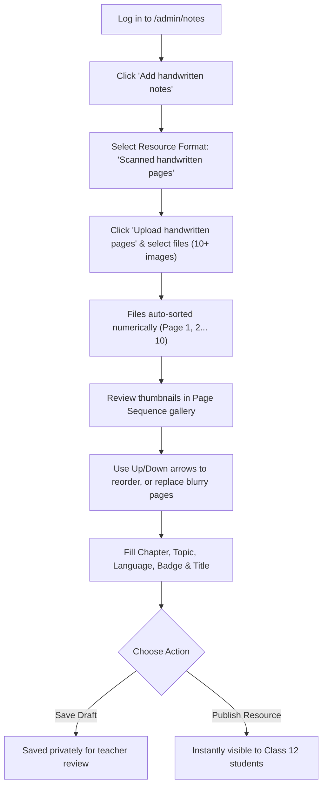

# SkillUp 12th Student Hub — Faculty & Administrator Content Management Guide

**Target Audience:** AVS Engineering College Faculty, Subject Teachers, and Platform Administrators  
**Platform:** SkillUp 12th Student Hub  
**Version:** 2026 Production Edition  
**Last Updated:** November 9, 2026  

---

## 1. Introduction & Portal Access

The SkillUp Platform empowers faculty members to upload, organize, edit, and publish Class 12 learning materials (Handwritten Study Notes and Educational Video Lessons) directly aligned with the Tamil Nadu State Board Higher Secondary curriculum.

### 1.1 Accessing the Portal
1. Navigate to the live website: `https://avs-12th-student-hub.vercel.app/` (or your local development URL).
2. Click **Sign In** in the top navigation bar or go directly to `/login`.
3. Enter your administrative credentials.
4. Once authenticated, access the management features:
   - **Handwritten Notes Manager:** `/admin/notes`
   - **Video Lessons Manager:** `/admin/videos`
   - **Student Directory & Approvals:** `/admin/students`
   - **Class Leaderboard & Points:** `/admin/leaderboard`

---

## 2. Handwritten Notes Management

SkillUp supports Class 12 study materials for all major Tamil Nadu State Board subjects, including **Mathematics, Physics, Chemistry, Computer Science, Bio-Botany, Bio-Zoology, General English, Tamil, Commerce, Accountancy, Economics, Computer Applications, and Business Mathematics**.

### 2.1 Notes Formats Supported
You can upload notes in two ways:
1. **Single PDF Document:** Ideal for compiled chapter question-and-answer banks, textbook solutions, or multi-page exercise guides.
2. **Scanned Handwritten Page Images (Multi-Page Support):** Ideal for photos taken of notebook pages, student working steps, or exercise sheets. Supported image types: **JPG, JPEG, PNG, and WebP**.

### 2.2 Handwritten Notes Style Guidelines
When preparing handwritten materials:
- **Paper:** A4 portrait layout, white or light-grey ruled paper with a red left margin.
- **Inks:** Blue ink for body explanations, problem working steps, and derivations; black ink for main headings and subheadings; red ink for highlights, key formulas, or final answer boxes.
- **Equations & Diagrams:** Ensure all labels, units (e.g., $N/C$, $m/s$, $\Omega$), and circuit/ray diagrams are legible and uncluttered.
- **Content Integrity:** Never skip intermediate solving steps, omit question numbers, or crop out margins containing question numbers.

### 2.3 Step-by-Step: Uploading Multi-Page Handwritten Notes

1. Go to **Admin Notes** (`/admin/notes`).
2. Click **Add handwritten notes** in the top-right corner.
3. Select **Resource Format** → **"Scanned handwritten pages (batch JPG / PNG / WebP)"**.
4. In the upload box, click **Upload handwritten pages**.
5. Select all the page images from your computer or phone. You can select 10, 20, or more images at once.
6. **Automatic Numeric Sorting:** The system automatically sorts files using natural numeric order (e.g. `Page 1.jpg`, `Page 2.jpg`, ... `Page 10.jpg`), so pages are never scrambled into alphabetical order (`Page 1, Page 10, Page 2`).
7. **Review & Arrange Pages:**
   - In the **Page Sequence** gallery, each page is shown with its page number badge (`P. 1`, `P. 2`).
   - Use the **Up Arrow** (<ArrowUp size={13} />) to move a page earlier in the sequence.
   - Use the **Down Arrow** (<ArrowDown size={13} />) to move a page later.
   - If a photo is blurry, click the **Replace Page** icon (<RefreshCw size={13} />) on that thumbnail and select a clearer photo.
   - If an accidental duplicate photo was selected, click the **Delete Page** icon (<Trash2 size={13} />). The page numbers will automatically adjust.
8. **Fill in Syllabus Details:**
   - **Title:** Descriptive title (e.g., *Physics — Ray Optics — Lens Maker Formula Derivation*).
   - **Tamil Title (optional):** Title in Tamil for Tamil-medium students.
   - **Chapter:** Select the exact State Board chapter from the dropdown menu (e.g., *Unit 6: Optics*).
   - **Topic:** Exercise or topic name (e.g., *Spherical Refraction & Thin Lenses*).
   - **Language:** Choose *English* or *Tamil*.
   - **Badge:** Select *HANDWRITTEN*, *IMPORTANT*, *REVISION*, or *EXAM FOCUS*.
   - **Allow Download:** Check this box if you want students to be able to download the file directly.
9. **Publish or Save Draft:**
   - Click **Save Draft** if you want to inspect it later before students see it.
   - Click **Publish Resource** to make it live for students immediately.

---

## 3. Educational Video Management

The video lesson system organizes learning videos across the curriculum hierarchy:  
**Class 12 → Medium (Tamil/English) → Subject → Unit/Chapter → Topic → Video Lesson**

### 3.1 Supported Video Sources
1. **Hosted MP4 Lessons:** Direct video lessons uploaded by faculty or hosted on CDN/storage.
2. **NotebookLM / Google Vids:** Lesson share links exported from NotebookLM or Google Workspace.
3. **YouTube Lessons:** YouTube links (standard, shortened `youtu.be`, or embed URLs).

### 3.2 Step-by-Step: Adding or Updating a Video Lesson
1. Go to **Admin Videos** (`/admin/videos`).
2. Click **Add a video lesson**.
3. Choose the **Video Source** type:
   - **Hosted MP4:** Click *Upload MP4 (up to 512 MB)* to upload a high-definition video file. The upload supports automatic pause/resume.
   - **NotebookLM:** Paste your NotebookLM share link into the URL field.
   - **YouTube:** Select *YouTube* and paste the link into the URL field.
4. Select the **Chapter** from the active syllabus dropdown.
5. Provide the **Topic** (e.g., *Lorentz Force and Cyclotron Motion*).
6. Enter the **Duration in Seconds** (automatically detected for uploaded MP4s).
7. Specify the **Teacher / Author** name (e.g., *AVS Physics Department*).
8. Choose **Save draft** or **Publish resource**.

---

## 4. Editing Existing Notes & Videos

Faculty members can edit existing materials at any time without creating redundant duplicates:
1. Locate the material in the list using the search bar, language filter, or status filter.
2. Click the **Edit** button (<Edit3 size={15} />) on the resource card.
3. The form opens pre-filled with the current details.
4. You can:
   - Update titles or descriptions.
   - Re-assign the material to a different chapter or topic.
   - Add more pages or reorder existing pages in a handwritten note.
   - Replace the video file or URL.
   - Change the badge or download permissions.
5. Click **Publish resource** (or **Save draft**) to apply the updates.

---

## 5. Moderation & Content Statuses

Every learning resource has a clear status:
- **Published (<Eye size={15} />):** The resource is live and visible to Class 12 students under its subject and chapter.
- **Archived / Draft (<Archive size={15} />):** The resource is stored safely in the database but hidden from students. Use this for works-in-progress, holiday revisions, or seasonal exam packs.
- **Delete (<Trash2 size={15} />):** Removes the listing from the curriculum. Note that source files in release storage are retained for safety against accidental deletion.

To toggle between Published and Archived, simply click the **Publish** or **Archive** button on the card.

---

## 6. Data Integrity & Student Safety Guidelines

> [!IMPORTANT]
> **Production Safety Rules:**
> 1. **Never Delete Student Records:** Real Class 12 student accounts, test scores, points balances, and bookmarked questions must be strictly preserved.
> 2. **Never Commit Large Media into Git:** Do not add MP4 or PDF files directly to Git commits. Use the administrative upload interface, which uploads to private cloud storage.
> 3. **Verify Chapter Mappings:** Always assign materials to the verified Tamil Nadu State Board chapter names to ensure students can locate their syllabus topics quickly.
> 4. **Audit Logging:** All administrative actions (creating content, updating metadata, publishing, archiving, and student approvals) are logged with timestamp and administrator ID in the audit trail.

